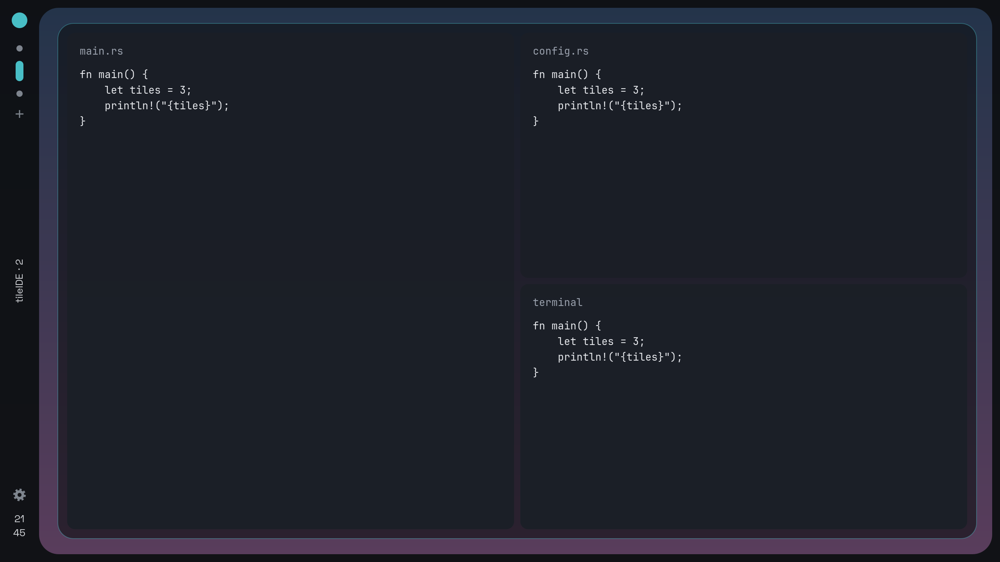

<div align="center">


</div>

<br>
<br>

# Welcome to TileIDE! 
This is an IDE tailored to how ricers experience unique and aesthetic desktop designs. 
Here, users can have workspaces, tiling-level experience, extension, mods, and even
have the config files of the application in a workspace by default (we really need this)!
This is like you riced a desktop for a year, and you can code with it.


## Features
* Tiling / split windows with custom super-key
* Typical tiling window manager config and design control
* Workspaces w/ default config workspace for application configs (you can turn this off)
* VIM level controls (optional)
* Typical IDE features such as extensions, mods, CLI, debugger, and execute
* Community extensions and mods


## Why I Made This
Tired of switching tiling window managers and customizing configs of IDE per switch. <br>
(tired of larping other distros)

<br>

> **Status: v0.0.0 preview.** A first build to try, not yet a daily editor: the config file isn't applied yet, and language features (completion, debugger) aren't in the UI yet.



# Quick Start
Arch
```
sudo pacman -S --needed base-devel git rustup gtk4 gtksourceview5 vte4
rustup default stable
git clone https://github.com/fordgarcia/tileIDE.git
cd tileIDE/packaging/arch && makepkg -si
tileide .
```
Optional font: `otf-space-grotesk` (AUR). Uninstall with `sudo pacman -R tileide`.

Debian / Ubuntu (untested; needs GTK 4.12 or newer, e.g. Ubuntu 24.04+)
```
sudo apt install build-essential git libgtk-4-dev libgtksourceview-5-dev libvte-2.91-gtk4-dev
curl --proto '=https' --tlsv1.2 -sSf https://sh.rustup.rs | sh
git clone https://github.com/fordgarcia/tileIDE.git
cd tileIDE && cargo install --path .
tileide .
```

## Usage
```
tileide                  # open the current folder (full-screen)
tileide ~/code/project   # open a folder
tileide src/main.rs      # open a file
tileide --windowed .     # open as a normal window
tileide --help           # all options, incl. backgrounds (--bg image:FILE)
```

| Keys | Action |
|---|---|
| `Alt+Return` / `Alt+E` | new terminal / new file |
| `Alt+W` / `Ctrl+S` | close tile / save |
| `Alt+H/J/K/L` (+`Shift`) | move focus (resize) |
| `Alt+1…9, 0` | workspaces |
| `Alt+B` / `Alt+C` | files drawer / config workspace |
| `Alt+Z` / `Alt+Escape` | word wrap / quit |

Mouse: the top circle opens the files drawer, a workspace dot previews its files, the gear opens the config.
Config lives in `~/.config/tileide/` (created on first run).

**Known limits:** tested on Hyprland only; on Hyprland, opening another app on TileIDE's workspace takes it out of full-screen.

# How to contribute
* You can create community mods and extensions: here you can basically call it a custom rice plugin and other packages such as code formatters, linters, and etc. Basically think of this as VSCODE + Zen
* For versions or releases, I will think about it once we're in the stable releases.

# License
[GPL-3.0-or-later](LICENSE)
