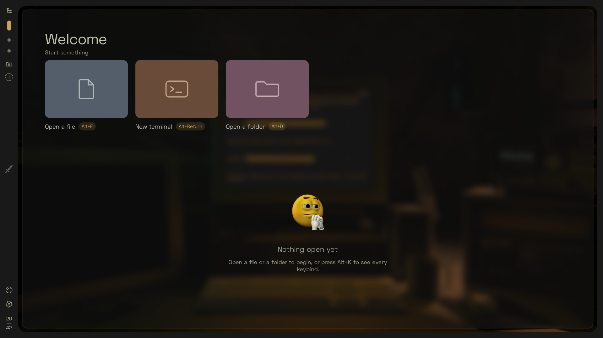
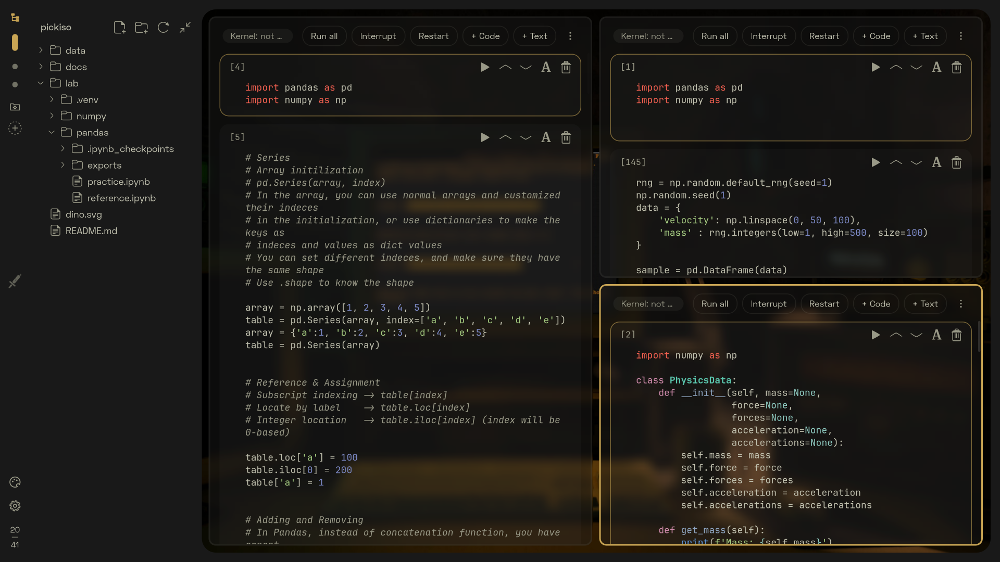
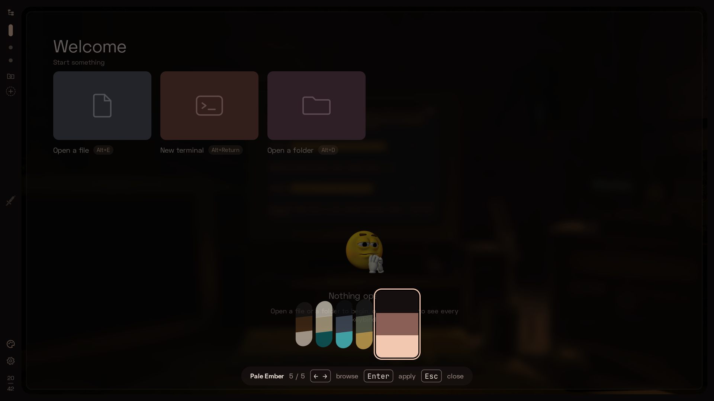
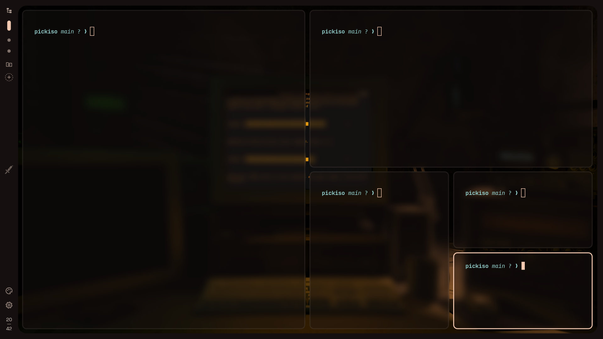

<div align="center">


</div>

<br>
<br>

# Welcome to TileIDE! 
This is a lighweight IDE created with Rust, tailored to how ricers experience unique 
and aesthetic desktop designs. Here, users can have workspaces, tiling-level experience, 
extension, mods, and even have the config files of the application in a workspace 
by default (we really need this)! This is like you riced a desktop for a year, and 
you can code with it.

** Note that this is still very early for development
## Current Features as of v0.5
* Horizontal, vertical, Niri-style tiling, and default style tiling (e.g Hyprland)
* Typical tiling window control support (keyboard)
* Code editor & terminal
* Linter, code-completion, suggestions (Python for now)
* Support for IPYNB
* Theme & Rice switcher
* Typical IDE features such as extensions, mods, CLI, debugger, and execute

## Current Plans to Implement till v1.0.0
* Vim level controls
* Community extensions and mods 
* Windows and other Linux distribution supports


<br>

<!-- > **Status: v0.5.0-alpha.5** (Settings, Run, notebooks, debugging for C/C++/Rust/Python/Java, audio visualizer). Tiling editors and terminals (dwindle or niri-style scrolling columns), workspaces, a Files drawer, themes (and VS Code theme import), language servers, extensions, and a Lua config that applies as you save it. Install details: [docs/install-arch.md](docs/install-arch.md). -->





@creadits to the artist of the wallpaper


# Quick Start
**Arch**
```
sudo pacman -S --needed base-devel git rustup gtk4 gtksourceview5 vte4 libarchive
rustup default stable
git clone https://github.com/fordgarcia/tileIDE.git
cd tileIDE/packaging/arch && makepkg -si
tileide .
```
`makepkg` builds a release, runs the test suite and installs `tileide`, a launcher entry and the sample config. Update with `git pull` and `makepkg -si` again; uninstall with `sudo pacman -R tileide` (your `~/.config/tileide/` stays). More in [docs/install-arch.md](docs/install-arch.md).

Optional, for the parts you use:
```
sudo pacman -S --needed pyright ruff python-ipykernel python-jupyter-client python-debugpy gdb
```
`pyright` + `ruff`: Python completion, diagnostics and formatting (with the Python picked with `Alt+P`, else the project's `.venv`) · `python-ipykernel` + `python-jupyter-client`: notebooks · `python-debugpy`: Python debugging · `gdb`: C, C++ and Rust debugging · `vscode-js-debug-bin` (AUR, `yay -S vscode-js-debug-bin`): JavaScript and TypeScript debugging · `otf-space-grotesk` (AUR): the intended UI font. Settings → Toolchains shows what TileIDE found and the command for anything missing.

**Debian / Ubuntu** (untested; needs GTK 4.12 or newer, e.g. Ubuntu 24.04+)
```
sudo apt install build-essential git libgtk-4-dev libgtksourceview-5-dev libvte-2.91-gtk4-dev libarchive-tools
curl --proto '=https' --tlsv1.2 -sSf https://sh.rustup.rs | sh
git clone https://github.com/fordgarcia/tileIDE.git
cd tileIDE && cargo install --path .
tileide .
```
Keep the clone: without the Arch package, the sample config and themes are read from it.

## Usage
```
tileide                  # open the current folder (full-screen)
tileide ~/code/project   # open a folder
tileide src/main.rs      # open a file
tileide --windowed .     # open as a normal window
tileide --wait .         # stay attached to the terminal until TileIDE closes
tileide --check-config   # check ~/.config/tileide/tileide.lua and exit
tileide --help           # all options, incl. backgrounds (--bg image:FILE)
```

| Keys | Action |
|---|---|
| `Alt+Return` / `Alt+E` | new terminal / open a file in a new tile (search; Enter on an empty search = blank file) |
| `Alt+F` | open a file in the focused tile (search) |
| `Alt+W` / `Ctrl+S` | close tile (asks if unsaved) / save |
| `Alt+←↑↓→` (+`Shift`) | move focus (resize) |
| `Alt+Ctrl+Shift+←↑↓→` | move the tile (column) |
| `Alt+V` / `Alt+S` | dwindle ⇄ scrolling columns (stacked tiles in the Wikipedia rice) / next tile opens below |
| `Alt+T` / `Alt+O` | theme tray / workspace overview |
| `Alt+1…9, 0` | workspaces |
| `Alt+B` / `Alt+C` | files drawer / config workspace |
| `Alt+D` / `Alt+Shift+W` | pick the workspace's folder / remove the workspace |
| `Alt+R` | run the focused file (output card; `Ctrl+C` stop, `Esc` close); in a notebook, run all cells |
| Notebook | `Shift+Enter` run and move on, `Ctrl+Enter` run; `↑`/`↓` at a cell's first/last line go to the next cell; `Backspace` in an empty cell deletes it; `Enter` edits a rendered text cell |
| Notebook command mode (`Esc`) | `↑`/`↓` or `K`/`J` move, `Shift+↑/↓` select several, `Enter` edit, `A`/`B` add above/below, `DD` delete, `Z` undo delete, `M`/`Y` text/code, `C`/`X`/`V` copy/cut/paste (`Shift+V` above), `Shift+Enter`/`Ctrl+Enter` run, `II` interrupt. The toolbar's ⋮ menu: run above/below, clear outputs, **Show variables** (a tile; a DataFrame's name opens it as a table). In outputs, traceback lines (`Cell In[3], line 5`, `File …:12`) are links, and output over 60 lines is folded |
| `Alt+L` | pick what `Alt+R` and `F5` launch in this workspace: a launch config, or the focused file |
| `Alt+P` | the Python for this project, or the notebook's kernel (also: click the kernel chip); also creates a `.venv` and installs `requirements.txt` in a terminal tile (uv, else pip) |
| `Alt+Shift+R` / `F8` | run tests with pytest (the test at the cursor, the test file, or all) in a Tests tile / go to the next failure |
| `F9` / `F5` | breakpoint / debug (start or continue); `F10` over, `F11` into, `Shift+F11` out, `Shift+F5` stop. In a notebook, `F5` debugs the current cell in its kernel (breakpoints in any cell apply; `Shift+F5` detaches, the kernel keeps running) |
| `Alt+,` / `Alt+K` | settings / keybinds |
| `Alt+=` / `Alt+-` | code font bigger / smaller |
| `Alt+Shift+T` / `Alt+Shift+X` | settings: themes & background / extensions |
| `Tab` | in an editor or cell, after a name or a `.`: complete (one match is filled in, else a list; as in Jupyter); elsewhere it indents. With the list open, `Tab` takes the selected item |
| `Alt+I` / `F12` / `Alt+Tab` or `Ctrl+Space` | hover info / go to definition / complete (Alt+Tab only where the desktop doesn't use it for window switching) |
| `Ctrl+Shift+I` | format the file, or the notebook cell (Ruff for Python; `%` and `!` lines are kept) |
| `Ctrl+Shift+O` | go to a name in the file (in a notebook, across all cells); type to filter |
| `F2` / `Shift+F12` / `Ctrl+.` | rename everywhere / list references / quick fixes |
| `Alt+Z` / `Alt+Escape` | word wrap / quit (asks if unsaved) |

Mouse: hovering a workspace dot previews its files (click to go, × to remove it); the file-tree button at the top opens the drawer; the folder-with-a-cog under the dots is the config workspace; the palette opens the theme tray; the gear above the clock opens Settings. On an empty workspace, the welcome cards open a file, a terminal or a folder.

## Settings (`Alt+,`)
Changes apply as you make them and are kept in `state.lua`; anything `tileide.lua` sets wins and shows as locked (**Unlock** comments that line out). The search field looks through every setting; the list on the left shows one section at a time:
- **Appearance, Editor, Layout, Motion, Sidebar, Alerts, Keyboard**: fonts and sizes, auto-closing brackets, borders, gaps, the tile limit, next-tile peek, animations, what the rail shows. Sliders change by dragging, clicking or the arrow keys; the mouse wheel scrolls the page.
- **Rice** (Layout): **Default** (the rail, Files as a drawer, tiles side by side) or **Wikipedia** (a top bar, Files on the left, workspaces on the right, tiles stacked top to bottom).
- **Themes & background**: themes for all workspaces or just this one, wallpaper (image, gradient or solid colour), transparency and blur, and **Import VS Code theme…** (a `.json` or `.vsix`).
- **Theme editor**: start from the theme in use, change its colours and watch the app follow, then **Save and use** (into `themes/`) or **Export…**.
- **Share → Export setup**: your config, Settings choices, themes, rices and background images in one `.tar.gz`. Unpacking it in `~/.config` on another machine restores the setup (back up first).
- **Editor → Format on save** (off by default): sorts imports and formats the file before writing it (Ruff for Python).
- **Editor → Inlay hints** (off by default): inferred types and parameter names at the end of each line, from servers that offer them (basedpyright, clangd, rust-analyzer, TypeScript; pyright doesn't).
- **Extensions** and **Toolchains**: what's installed, what it costs, and which compilers, interpreters and debuggers were found. Toolchains starts with **This project**: its Python and the Ruff, pyright and pytest settings from `pyproject.toml`, `ruff.toml` or `pyrightconfig.json` (read-only).

## Config
Config lives in `~/.config/tileide/` (created on first run): `tileide.lua`, `rices/` (layout and design) and `themes/` (colours only). Saved changes apply at once; `tileide --check-config` checks the file from a shell. Every key above can be rebound with `tileide.bind(mods, key, action, arg)`. Actions: `workspace` (1–10 or `"config"`), `sidebar`, `layout` (`toggle`/`dwindle`/`columns`/`stack`), `split` (`vertical`/`horizontal`), `focus`/`move`/`resize` (`left`/`right`/`up`/`down`), `close`, `terminal`, `editor`, `search`, `wrap`, `save`, `quit`, `overview`, `themes`, `themes_section`, `folder`, `workspace_close`, `hover`, `definition`, `complete`, `format`, `rename`, `references`, `code_action`, `outline`, `extensions_section`, `extension` (a command id), `settings`, `keybinds`, `font_size` (`up`/`down`), `run`, `debug`, `debug_stop`, `breakpoint`, `step_over`, `step_into`, `step_out`, `toolchains`, `interpreter`, `test`, `next_failure`, `launch`. Add or change what `Alt+R` runs with `tileide.runner(".py", "python3 -u {file}")`.

**Launch configs** (picked with `Alt+L`, then used by both `Alt+R` and `F5`): `tileide.launch { name = "server", program = "src/main.py", args = { "--port", "8080" }, env = { DEBUG = "1" }, cwd = "${workspaceFolder}" }`. A project's `.vscode/launch.json` is read too (its `launch` configurations' `name`, `program`, `args`, `env`/`environment` and `cwd`). `program` is a source file (run or debugged as `Alt+R`/`F5` would), a Cargo project folder, or an executable (debugged with gdb). VS Code's variables work (`${workspaceFolder}`, `${file}`, `${fileDirname}`, `${fileBasenameNoExtension}`, `${env:NAME}` …); relative paths start at the workspace folder.

Extensions are programs in any language that run in their own process and start only when needed; the Extensions section shows what each one costs. See [docs/extensions.md](docs/extensions.md) and [docs/compatibility.md](docs/compatibility.md).

**Known limits:** tested on Hyprland (Arch) only; on Hyprland, opening another app on TileIDE's workspace takes it out of full-screen (set `misc:on_focus_under_fullscreen = 0`, or use `--windowed`).

# How to contribute / Suggestions
still in progress...


# License
[GPL-3.0-or-later](LICENSE)
