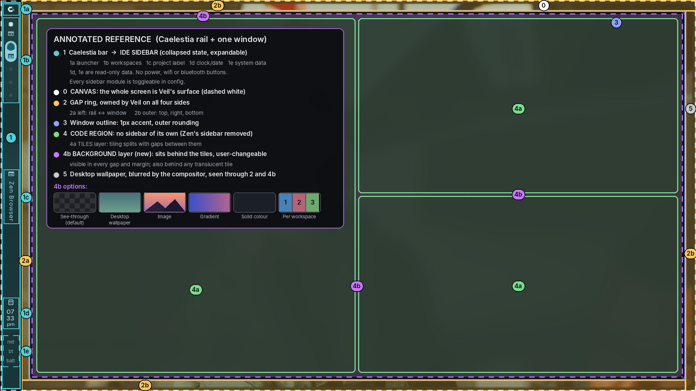

# DESIGN.md — TileIDE

> Companion to `../project_context.md` (features) and `../versions/` (what ships when). This file is the **brief and rulebook for Claude Design**. Nothing is built from it until **you approve** each stage (§10).
> **Status:** Draft 1 · 2026-10-31 · Linux, Hyprland-first, dark-first.
> **Always attach with this file:** `annotated_layout.png`.

---

## 1. How to use this file

1. Attach this file **and** `annotated_layout.png` when starting a design session.
2. Claude works in the **stages in §10**, in order, and stops at the end of every stage for your verdict.
3. Approved decisions are written into the **Design System** artifact (tokens, components). Later screens may use only those tokens.
4. Rejected directions go in §13 so they are never proposed again.

**Instruction priority:** your words in chat > this file > the design skills' defaults. The skills say the brief wins; this file is that brief.

## 2. Reference image and what it means



The image is your Zen Browser on Hyprland with Caelestia's bar, annotated. **Region numbers below are the vocabulary for every design conversation.**

| # | Region in the image | Becomes in TileIDE | Design rule |
|---|---|---|---|
| **0** | Canvas | **The whole screen is TileIDE's surface** (dashed white border in the image) | Everything inside is designed by us; transparent where nothing is drawn |
| **1** | Caelestia bar (≈ 50px wide at 1920×1080) | **Sidebar.** Collapsed = looks like this bar. Expandable. | Collapsed state must be recognisably Caelestia's bar. |
| 1a | Launcher / logo | Sidebar toggle | Top of rail |
| 1b | Workspace indicators | TileIDE workspaces 1–9 | Active workspace clearly distinct; Hyprland-style dots/pills |
| 1c | Vertical rotated label | Active workspace / project name | Rotated text, as in the image |
| 1d / 1e | Clock/date, system data | **Read-only data modules.** No buttons. Each toggleable in config. | Design as small text/glyph readouts, not icon buttons |
| ~~1f~~ | Power button | **Removed** | Do not design power, wifi or bluetooth buttons anywhere in the rail |
| **2** | Gap ring around the window | **Owned by TileIDE on all four sides.** | Wallpaper visible through it |
| 2a | Left gap, rail ⇄ window (≈ 24px) | Token `gap.rail` | Measured from the screenshot |
| 2b | Outer gap, top / right / bottom (≈ 30px) | Token `gap.outer` | Measured from the screenshot |
| **3** | Window outline: 1px cyan/teal | Same | Accent at low alpha; brighter when focused |
| **4** | Content panel, extended to the window edge (Zen's ≈ 272px sidebar is gone) | **Code region**: tiling, **no sidebar, no tab strip unless approved (Q5)** | Two layers: tiles on top, background behind |
| 4a | Tiles layer | Editors, terminals, run output | Gaps between tiles; the splits shown in green are an example |
| 4b | **Background layer** | User-changeable: see-through (default), desktop, image, gradient, solid, per-workspace | Visible in every gap, margin and behind translucent tiles. See §4.6 |
| **5** | Blurred desktop wallpaper | Compositor blur | Mockups simulate it (§4.2) |

**The whole image is TileIDE's canvas.** Rail, gap ring and window are all part of the IDE's design; the only thing that isn't ours is the wallpaper behind it.

Observed in the screenshot (facts, not interpretation): single window floating over a blurred wallpaper; dark translucent surface; a 1px cyan outline; a narrow vertical bar outside the window; almost no chrome (no title bar, no menu bar, no toolbar clutter); soft rounding on the content panel.

## 3. Design principles (ranked; earlier wins ties)

1. **Content is the interface.** The code region gets the most pixels and the highest contrast; chrome is the quietest thing on screen.
2. **Collapsed is the default and must look finished.** Most of the time the user sees only the rail and the code region. The expanded sidebar is a visit, not the home state.
3. **Translucent, never illegible.** Blur is atmosphere; text on any translucent surface still meets contrast (§7). Editor tiles are the most opaque layer.
4. **Everything is a token.** Radius, fillet, every gap, opacity, blur hint, colour, motion: all editable from the config file. A design that needs a value that isn't a token means a token is missing.
5. **Tiles, not chrome.** Anything that would normally be a panel (terminal, problems, debug) is a tile in the code region.
6. **Fast feels designed.** Short, purposeful motion (§8).
7. **Keyboard first, mouse friendly.** Every surface shows its shortcut; every action is in the palette.
8. **Implementable.** If it can't be drawn with the chosen Rust toolkit's primitives (paths, clips, shaders), it doesn't ship. Mockups are web; the app is not.

## 4. Visual language

### 4.1 Geometry

Terminology (use exactly these words in designs and code):

- **Rail**: the collapsed sidebar (region 1).
- **Drawer**: the expanded part of the sidebar that grows out of the rail.
- **Window**: the outlined, translucent rectangle (region 3).
- **Code region**: the inside of the window (region 4), made of the **tiles layer** (4a) over the **background layer** (4b).
- **Tile**: one pane inside the code region.
- **Frame** (decided 2026-10-31, reference `caelestia-reference.png`): the rail plus a thin solid border along the top, right and bottom canvas edges, drawn as **one shape**: the canvas minus a rounded hole. The rail is the frame's wide left side; the **drawer is the rail widening**, and the hole's rounded corners move with it. This replaces the earlier separate rail-and-drawer fillet design.
- **Fillet (`f`)**: a **concave** curve where two shapes merge. In the frame model, the hole's rounded corners *are* the fillets.
- **Radius (`r`)**: convex rounding.
- **Gaps**: four distinct ones: `gap.rail` (2a), `gap.outer` (2b), `gap.tile.in`, `gap.tile.out` (§4.1 table). Don't conflate them.

```
 ┌──┐   ┌───────────────────────────────────────────┐
 │▪ │   │ ┌───────────────┐ ┌──────────────────────┐│
 │1b│   │ │               │ │                      ││
 │  │ g │ │    tile       │ │       tile           ││
 │  │ a │ │               │ │                      ││
 │1c│ p │ │               │ ├──────────────────────┤│
 │  │ 2 │ │               │ │       tile           ││
 │1d│   │ └───────────────┘ └──────────────────────┘│
 └──┘   └───────────────────────────────────────────┘
 rail                        window (code region inside)

 Expanded: the drawer grows out of the rail (with a concave fillet at the join);
 the gap and the window keep their relationship (push vs overlay: Stage 2).
```

| Token | Start | Note |
|---|---|---|
| `rail.width` | 50px | measured from the screenshot |
| `drawer.width` | 280px | Zen's sidebar was ~272px; tune in Stage 2 |
| `gap.rail` (2a) | 24px | measured; between rail/drawer and window |
| `frame.border` | 10px | border on the top, right and bottom canvas edges (Caelestia reference) |
| `frame.radius` | 25px | rounded corners of the frame's inner edge (Caelestia reference) |
| `frame.opacity` | 0.95 | the frame is near-solid, like Caelestia's |
| `gap.outer` (2b) | 20px | frame's inner edge to the window on top, right and bottom (was 30px from the screen edge before the frame existed) |
| `gap.tile.in` | 8px | between tiles |
| `gap.tile.out` | 12px | tiles to window edge |
| `outline.width` | 1px | accent ≈ 35% alpha; brighter on focus |
| `window.radius` | 20px | outer corners |
| `tile.radius` | 10px | **smaller than window radius**: nested shapes need smaller radii |
| `region.padding` | 12px | inside the drawer |
| `background.mode` | see-through | see-through / desktop / image / gradient / solid |
| `background.dim` | 30% | darkening to protect legibility |
| `background.blur` | 0px | app-drawn modes only; compositor does the see-through blur |
| `background.tint` | none | colour overlay |
| `tile.opacity` | 0.92 | editor tiles never below 0.88 |

### 4.2 Surfaces and translucency (back to front)

| Layer | Role | Opacity (start) |
|---|---|---|
| L0 | Wallpaper (compositor) | n/a |
| L1 | Rail and drawer base (blurred behind) | 60–75% |
| L2 | Window base (blurred behind) | 55–70% |
| L2b | **Background layer (4b)**: see-through, or an app-drawn image/gradient/solid | 100% when app-drawn; see-through by default |
| L3 | **Editor tile surface** | 88–96% (most opaque) |
| L4 | Floating (palette, menus, tooltips) | 92–98% |

Mockups **simulate** blur with a wallpaper image + `backdrop-filter`. The real app gets blur from the compositor (T3 in `../project_context.md`). Every screen also ships a **solid fallback** variant.

### 4.3 Colour

Dynamic scheme: tokens, not fixed colours; the user swaps a theme file (and later derives one from the wallpaper).

Starting palette for default theme **"Dusk"** (derived from your screenshot's dark neutral + cyan outline; to be approved in Stage 1):

| Token | Hex | Use |
|---|---|---|
| `surface.base` | `#0E1013` | L1/L2 (apply alpha) |
| `surface.region` | `#15181D` | drawer sections |
| `surface.editor` | `#1B1F26` | L3 tiles |
| `text.primary` | `#E6E8EC` | main text |
| `text.muted` | `#9AA1AD` | secondary |
| `accent` | `#4FD1D9` | outline focus, selection, active workspace |

Semantic tokens to define in Stage 1: `success`, `warning`, `error`, `info`, `selection`, `find-match`, `diff-add/remove`, `breakpoint`, `current-line`, `tile-focus`, and a **syntax set** (keyword, string, number, comment, function, type, variable, operator, punctuation).

> ⚠ **Honest warning:** "near-black + one bright accent" is flagged as an overused default in the `frontend-design` skill. The skill says the brief overrides defaults, so it's allowed, but it means the *default theme can't be the interesting part*. Spend boldness on **the rail/drawer relationship and tile motion**, and make Stage 1 produce **three genuinely different themes**, not recolours.

### 4.4 Typography

- **Editor:** monospace for code legibility and ligatures. Claude proposes **2 candidates** with real code samples; you choose.
- **UI: Space Grotesk** (decided 2026-10-31), 12–13px base. Code stays monospace.
- **Scale:** 11 / 12 / 13 / 14 / 16 / 20. Sentence case; no ALL-CAPS labels by default.
- Line height: editor 1.5, UI 1.35.
- **Vertical label (1c):** rotated text is a deliberate Caelestia trait; choose weight/tracking so it stays legible at small size.
- Icons: one family, consistent stroke, 16px grid (the rail's icons are small; test at 14–16px).

### 4.5 Density

Two modes, both tokens: **Compact** (default, 24px rows) and **Comfortable** (28–32px). Minimal ≠ sparse: quiet comes from few elements, not big empty areas.

### 4.6 Background layer (region 4b) design rules

- It is a **layer**, not a wallpaper. It lives between the desktop and the tiles and is shown through **gaps, margins and translucent tiles**.
- **Windowed mode has no app background** (transparent, blends with the user's desktop). **Full-screen mode** draws the chosen background across the whole canvas (`../project_context.md` §4.4). Mockups of S1 need both.
- Default is **see-through**: the compositor's blurred desktop wallpaper, as in the reference screenshot.
- App-drawn modes (image, gradient, solid) must work **without compositor blur**; they are also the solid fallback (§4.2).
- Every custom background ships with **dim, tint and tile-opacity controls** and a visible **legibility warning**.
- Show gaps (`gap.tile.in`, `gap.tile.out`) generously enough that the background reads as designed, not as leftover space: with a photo behind, 8px gaps may need to grow.
- Mockups must show the same screen on **at least three backgrounds**: a bright photo, a dark photo, a solid colour.
- The picker (S1f) lives in the **Themes** section; backgrounds are **mods** (data-only Lua), never extensions.

## 5. Core screens

| # | Screen | Purpose | Notes |
|---|---|---|---|
| S1 | **Main window, sidebar collapsed** | Everyday state | Rail (1a–1e) + gap + window with 3 example tiles (Python editor, second editor, terminal) |
| S1b | **Sidebar expanded: Files** | Browse the workspace's tree | Tree re-roots when workspace changes |
| S1c | **Sidebar expanded: Extensions** | Install/manage | Weight badges, per-workspace toggle, mods ≠ extensions |
| S1d | **Sidebar expanded: Themes** | Pick/preview themes | Live preview applies to the real window |
| S1f | **Background picker** (inside Themes) | Choose and preview the background layer | Modes as swatches; sliders for dim/blur/tint/tile opacity; legibility warning; per-workspace toggle |
| S1e | **Sidebar expanded: Config → Config workspace** | Edit the app's config | Code region shows config files with live preview and inline errors |
| S2 | **Command palette** | Do anything | Also file switcher; L4 floating |
| S3 | **Workspace overview** | `Mod+N` (TileIDE modifier) navigation | Grid of workspaces 1–9, must feel like Hyprland's overview |
| S5 | **Weight meter** | Keep it light | Per-extension startup/RAM/CPU, suspend |
| S7 | **Run / Debug** | F5 workflows | Variables, call stack, output as **tiles** |
| S8 | **Toolchain manager** | Compilers/runtimes | Detected, pin per workspace, friendly "missing" state |
| S9 | **First-run welcome** | Onboarding | Skippable |
| S10 | **Empty / error / loading states** | Everything else | Guide, don't apologise |

Content rule: **no lorem ipsum.** Real code (a Python file, a Rust file), real file trees, real extension names, real errors.

## 6. Component inventory (Stage 1 builds these)

- **Rail:** launcher, workspace pill/dot, vertical label, clock module, system-data module (read-only). **Every module optional** (config).
- **Drawer:** section header, section switcher, tree row, extension row (weight badge), theme card, config file row.
- **Window/tiles:** tile (with focus state), tile gap handle (resize), split indicator, optional tile title strip.
- **Inputs:** text field, search field, toggle, select, keybind recorder, token picker.
- **Overlays:** palette, menu, tooltip, toast, modal (rare).
- **Editor chrome:** gutter, minimap (optional), scrollbar, selection, diagnostics squiggle, inline error.
- **Terminal:** prompt area, ANSI 16 colours from tokens.
- **Badges:** weight (light/medium/heavy), status (active/dormant/suspended), compatibility (works/partial/untested).

## 7. Accessibility floor (non-negotiable)

- Text contrast ≥ 4.5:1 against the **worst-case wallpaper** behind a translucent layer (test a bright and a dark wallpaper).
- Visible keyboard focus everywhere; focus uses `accent` and never relies on colour alone; **the focused tile must be unmistakable without colour** (e.g. outline weight).
- Reduced-motion: drawers and tiles change state instantly.
- Diagnostics never by colour alone.
- Hit targets ≥ 24px in Compact mode (the rail's 50px width makes this easy; check the dots in 1b).

## 8. Motion

Borrow the philosophy of the `emil-design-eng` skill (fast, purposeful, ease-out, interruptible) and Hyprland's own short curved animations.

| Interaction | Duration | Easing | Note |
|---|---|---|---|
| Drawer expand/collapse (rail ⇄ drawer, fillet reshapes) | 180–220ms | ease-out | Fillet path animates; section content fades slightly later |
| Tile open/close/split | 120–160ms | ease-out | Neighbouring tiles reflow smoothly |
| Workspace switch | 140–180ms | ease-out | Direction = workspace order; rail indicator updates first |
| Palette appear | 120ms | ease-out | Scale 0.98 → 1 + fade |
| Hover/focus | ≤ 100ms | ease-out | colour only |
| Repeated keyboard actions (focus moves, tab/tile switching) | 0ms | none | **never animate high-frequency keyboard actions** |

All animations interruptible · no ambient looping motion · everything off under reduced-motion.

## 9. Skills: what we have, what we don't

### 9.1 Available now (verified in this environment)

| Skill / tool | Use for | Caveat |
|---|---|---|
| `frontend-design` | Distinctive direction, typography, anti-template critique, token-first planning | Web/marketing-leaning; its "defaults to avoid" list includes near-black + single bright accent and zero-radius/hairline layouts, so **declare our direction explicitly** (done in §4) |
| `design-taste-frontend` | Has an **app-screen** path (dashboards, settings, editors/builders) with house rules (quiet borders, small labels OK; gradients, glows, rainbow charts not OK) and a look-and-fix screenshot loop | Use only the **app-screen** path; the page workflow deals "researched directions" we don't need. Needs Node 22+ and a Chromium-family browser |
| `emil-design-eng` | UI polish, animation decisions | Matches §8 |
| **Design** artifact type | Live artboards on a canvas: our screens | Web-based mockups, not the real app |
| **Design System** artifact type | Tokens, components, guidelines, assets | Home of approved tokens |
| `artifact-design` | Page contract for published artifacts | n/a |
| `diagram` (Kroki) | Diagrams for docs | Needs network access; may be blocked |
| `skill-creator` | **Build the missing skills below** | |
| `docx` / `pdf` / `pptx` / `xlsx` | Review packs | Only if you want a shareable pack |

### 9.2 Missing (recommend creating, in this order)

| Missing skill | Why | Contents |
|---|---|---|
| **1. `rail-drawer-geometry`** (replaces my earlier "curved-panels") | The signature interaction has no skill | SVG path/CSS-mask recipes for rail + drawer with concave fillet, outer radii, animated path morph, resize behaviour |
| **2. `tiling-layout-ui`** | Hyprland-style tiling UI is unfamiliar to web-trained defaults | Dwindle/master layouts, gap handling, focus indication, resize handles, keyboard model |
| **3. `ide-design-tokens`** | Tokens map to *three* targets: our Lua theme file, CSS variables, VS Code theme JSON (for importing VS Code themes) | Naming, alpha handling, export, syntax-token mapping |
| **4. `vscode-theme-mapping`** | Extensions and imported themes expect VS Code keys | Mapping table tokens ↔ `workbench.colorCustomizations`, TextMate/semantic scopes |
| **5. `translucent-ui-testing`** | Contrast depends on the wallpaper | Worst-case wallpaper contrast checks, solid-fallback generation |
| **6. `icon-set-svg`** | One consistent 16px icon family | Grid, stroke rules, sprite export |
| **7. `desktop-app-ui-linux`** | Wayland/Hyprland-native feel | Frameless windows, drag regions, what blur/transparency can and can't do |
| 8. `quickshell-qml-reference` *(only if fallback R4, Qt/QML, is chosen)* | Caelestia-style structure natively | QML patterns for drawers and panel joins |
| 9. `rust-wayland-ui` | Rust-specific patterns for the chosen toolkit | gtk4-rs or GPUI-style drawing, layer-shell, transparent surfaces, input regions, text rendering |

> Honest note: I have **not** verified how well the available skills handle *desktop-app* designs versus web pages. Stage 3's first screen tests that. If it looks like a website in a window, write skills 1 and 2 first.

## 10. Approval workflow (stages and gates)

Each stage ends with **your verdict** (Approve / Revise / Reject). Claude must not start the next stage on its own.

### Stage 0: Reference board
- Claude restates §2 in its own words, using region numbers, and lists what it doesn't know (e.g. Caelestia's exact current look, the rail's real icon set).
- ✅ Gate: you correct any wrong reading.

### Stage 1: Design System (tokens)
- Build the **Design System artifact**: three genuinely different themes (each with a solid fallback), type scale with 2+2 font candidates, spacing/gap tokens (§4.1 table), radius/fillet, motion tokens, icon family.
- ✅ Gate: pick 1 monospace, 1 UI font, 1 icon style; approve at least one theme.

### Stage 2: Rail ⇄ drawer study (the make-or-break)
On a **Design** canvas, using the same content skeleton, show **three** expansion behaviours, each at *collapsed, expanding (mid-animation), expanded, narrow window*:
- **A. Overlay drawer:** the drawer grows out of the rail with a concave fillet and covers part of the gap/window edge. Tiles don't move.
- **B. Push drawer:** the drawer grows, the window shrinks, `gap.rail` stays 24px; tiles reflow.
- **C. Push, gap collapses:** the drawer merges with the window (Caelestia-style full merge) while expanded; the gap returns on collapse.
- For each: one thing it does better and one worse, then ask me one question to choose.
- ✅ Gate: pick A, B, C or a mix; tune `rail.width`, `drawer.width`, `gap.rail`, `frame.border`, `frame.radius`.

### Stage 3: Main window, collapsed (S1)
- Real Python file, terminal tile, three tiles total; **blur-simulated** and **solid fallback**; two wallpapers (bright and dark).
- Show the **background layer** in three modes: see-through, a custom photo, a solid colour. Prove code stays readable in all three.
- Show the focused-tile state and a tile-resize interaction.
- ✅ Gate: rail fidelity to Caelestia, tile gaps, outline, density.

### Stage 4: Tiling study (S1 variations)
- Dwindle vs master layouts; `gap.tile.in` 0 / 8 / 16; with and without a tile title strip (Q5).
- ✅ Gate: choose.

### Stage 5: Drawer sections (S1b, S1c, S1d, S1e)
- Files, Extensions (with weight badges; mods vs extensions distinct), Themes (**including the background picker, S1f**), Config (→ Config workspace with live preview and inline validation).
- ✅ Gate.

### Stage 6: Overlays and navigation (S2, S3, S5)
- Palette, workspace overview, weight meter.
- ✅ Gate.

### Stage 7: Run/Debug and toolchains (S7, S8)
- Debug output as tiles.
- ✅ Gate.

### Stage 8: Onboarding and states (S9, S10)
- ✅ Gate.

### Stage 9: Handoff package
- Approved tokens (Design System), component sheet, screenshots at 3 widths, and an **implementation notes** page: which element maps to which token, which pieces need the compositor, which need custom path drawing.

## 11. Prompt templates (copy/paste)

**Start:** "Read `project_contexts/design/design.md` and `project_contexts/project_context.md`, and look at `project_contexts/design/annotated_layout.png`. Do Stage 0 only. Tell me what you understood using the region numbers, what you're unsure about, and what you'd need to look up. Don't design anything yet."

**Stage 2:** "Do Stage 2 only. Build options A/B/C for the rail ⇄ drawer behaviour on one Design canvas, same content, four states each. For each, one thing it does better and one worse. Then ask me one question that would help me choose."

**Revise:** "Revise only [X]. Keep every approved token unchanged. If you need a new token, propose it first and wait."

**Challenge:** "Argue against the design you just made. What would a Hyprland rice user hate? What breaks on a bright wallpaper? What breaks when two bars (Caelestia's and ours) are visible?"

## 12. Anti-goals (do not produce)

- Card grids of identical rounded boxes; one radius on everything (nested radii must shrink).
- Gradient washes, glows and neon as decoration.
- Purple/blue "AI" gradients.
- Fake metrics, marketing-page patterns.
- A sidebar *inside* the window (Zen's was removed).
- A busy or bright background under code with no dim, tint or tile opacity to protect legibility.
- Animated/video backgrounds in the default designs (continuous cost; not in scope yet).
- A dedicated bottom panel or tab bar chrome (everything is a tile) unless approved.
- Heavy drop shadows (translucent surfaces separate by tone and blur).
- Tracked-out ALL-CAPS eyebrow labels; "→" on every button.
- Anything not re-themable through tokens.
- Power, shutdown, wifi, bluetooth or any system-control buttons in the rail.
- Sidebar modules that cannot be turned off in the config.

## 13. Rejection log

_(empty; Claude appends rejected directions with a one-line reason)_

## 14. Open design questions

1. Collapsed rail: copy Caelestia's modules exactly, or only the *shape and spacing*?
2. Does the expanded drawer push or overlay (Stage 2 decides), and does it keep the 24px gap?
3. Does each tile have a title strip/tab, or is tile = buffer with no chrome (Q5 in `../project_context.md`)?
4. Which read-only data belongs in 1e (network, bluetooth, battery, CPU/RAM), and is each text, a glyph or a tiny graph?
5. Light theme: required, or optional? (Translucent light themes are hard to keep legible.)
6. Gap ring: one value for 2a and 2b, or two? Should `gap.outer` be allowed to go to 0 (flush window)?
7. ~~Background scope~~ **Decided:** full-screen = one continuous app background behind rail, gap and tiles; windowed = no app background (`../project_context.md` §4.4).
8. Which background modes ship first? (Suggested: see-through, image, solid.)
9. What is the one moment a rice user would screenshot and post? That becomes the single boldest element.
