# PROJECT_CONTEXT.md — TileIDE

> **Status:** Draft 2 · 2026-10-31 · Linux only (Wayland/Hyprland first) · **Built from scratch in Rust**
> **Scope of this file:** *what the product is and does* (features, concepts, architecture, risks). **When** things get built lives in `versions/v0.0.md … v1.0.md`. **How it looks** lives in `design/design.md`.
> **Name: TileIDE** (decided 2026-10-31; earlier drafts used the placeholder "Veil"). Anything marked **[VERIFY]** is an assumption, not a fact; v0.0 exists to confirm or kill it.

---

## 1. Pitch

A Linux IDE that looks like it belongs on a riced Hyprland desktop and behaves like VS Code. A slim Caelestia-style sidebar expands into the file tree, extensions, themes and config; next to it, a translucent, blurred window holds a tiling code region. Everything is controlled by short, hand-editable **Lua** config files with hot reload. It is written from scratch in Rust. Language support comes through LSP and DAP, VS Code themes, grammars and snippets can be imported, and TileIDE has its own plugin system. It starts light and is designed to *stay* light as users add mods.

## 2. Non-goals (for now)

- Windows / macOS (Linux only until v1.0 is stable).
- Bundling compilers (we **discover and link** toolchains; §6.4).
- Running VS Code API extensions, or forking VS Code or Theia (TileIDE is built from scratch in Rust; T1).
- AI features, collaboration, remote development.
- Equal support for every compositor (Hyprland first; others degrade gracefully).

## 3. Pillars → concrete deliverables

| Pillar | Wish | Deliverable |
|---|---|---|
| **Caelestia** | Slim side bar, drawers, curved joins | The sidebar: a collapsed rail that looks like Caelestia's bar and expands as a **drawer** with a concave fillet where it joins the rail (§4.2). |
| **Zen** | Minimal, blur, transparent, themeable | A frameless, translucent window with a **user-changeable background layer** (§4.4), with a 1px accent outline, near-zero chrome, and **no sidebar inside the window** (the Caelestia-style one replaces it). Themes are token files. |
| **VS Code** | Extension library | **Reframed:** LSP and DAP built in; VS Code **declarative content** (themes, grammars, snippets, keybindings) imported from Open VSX; TileIDE's own **plugin system**. VS Code API extensions are **not** supported (T1). |
| **Hyprland** | Simple configs, tiling, workspaces | One Lua config for everything (keybinds, rules, themes, rices); a tiling code region; numbered workspaces (`Mod+1..9`, TileIDE's own modifier, §4.5); hot reload. |

## 4. Layout and regions

Reference: `design/annotated_layout.png` (your Caelestia + Zen screenshot with each component labelled).

**The whole image is TileIDE's canvas (region 0).** The rail, the gap ring around the window, and the window itself are all drawn by TileIDE. Nothing in the picture is the desktop's own except the wallpaper behind it.

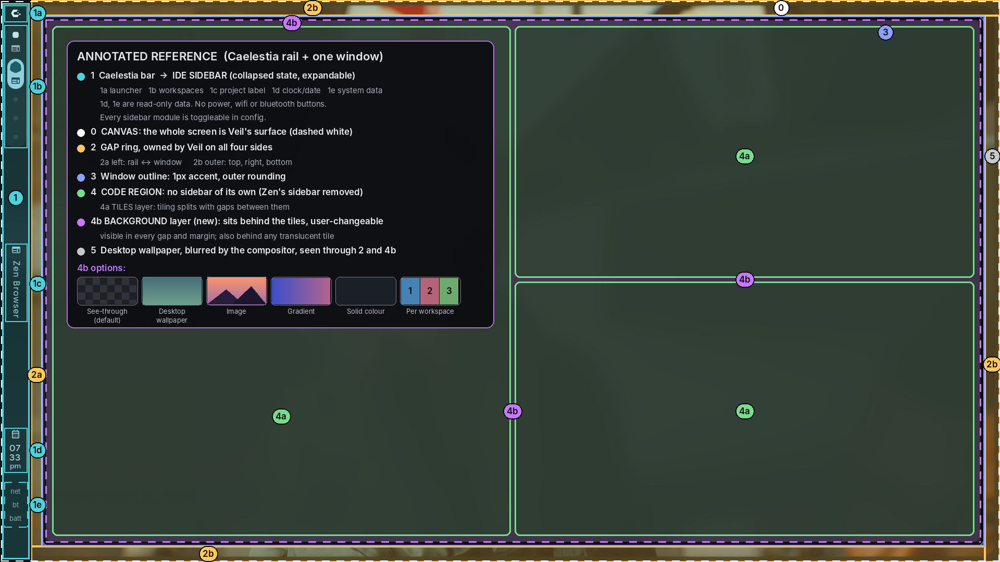

| # | Region | In TileIDE |
|---|---|---|
| **0** | Canvas | **The whole screen is TileIDE's surface.** Mostly transparent; solid only where TileIDE draws something (T12). |
| **1** | Caelestia bar | **The IDE sidebar.** Collapsed = looks like Caelestia's normal bar. Expandable. |
| 1a | Launcher / logo | Toggles the sidebar |
| 1b | Workspace indicators | The IDE's workspaces (1–9) |
| 1c | Vertical label | Active workspace / project name |
| 1d | Clock / date | **Read-only data module.** No buttons. Toggle in config. |
| 1e | System data (read-only) | Shows data such as network, bluetooth and battery as text or glyphs. **No buttons** (no wifi, bluetooth or other controls). Each item toggleable in config. |
| ~~1f~~ | ~~Power button~~ | **Removed.** No shutdown, restart or session buttons in the rail. |
| **2** | **Gap ring** around the window | **Owned by TileIDE on all four sides.** Wallpaper shows through. |
| 2a | Left gap (rail ⇄ window) | ≈ 24px measured. Token `gap_rail`. |
| 2b | Outer gap (top, right, bottom) | ≈ 30px measured. Token `gap_outer`. |
| **3** | Window outline | 1px accent outline, outer rounding |
| **4** | Content panel → **code region** | Tiling, **no sidebar of its own** (Zen's own sidebar is removed; region 1 replaces it). Extends to the window edge. |
| 4a | Tiles layer | Editors, terminals, run output, split with gaps |
| 4b | **Background layer** | Behind the tiles; visible in gaps, margins and behind translucent tiles. **User-changeable** (§4.4) |
| **5** | Desktop wallpaper | Blurred by the compositor |

### 4.1 Layout diagram

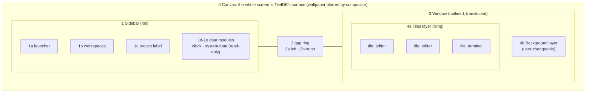

### 4.2 Sidebar (region 1)

**Everything in the sidebar is optional.** Every rail module and every drawer section can be switched off in the config (`sidebar { show_* }`, §6.3). The rail has **no buttons for system actions** (no power, wifi or bluetooth buttons); it only *shows* data.

**Two states.**

- **Collapsed (default):** the rail only, visually the same as Caelestia's normal bar.
- **Expanded:** a drawer grows out of the rail. Sections:
  1. **Files**: the file tree of the *active workspace* (it re-roots when you switch workspace).
  2. **Extensions**: installed and available extensions, per-workspace rules, weight badges.
  3. **Themes**: local and installed themes, live preview.
  4. **Config**: the app's own config files; opens them in the **Config workspace** (§6.2).

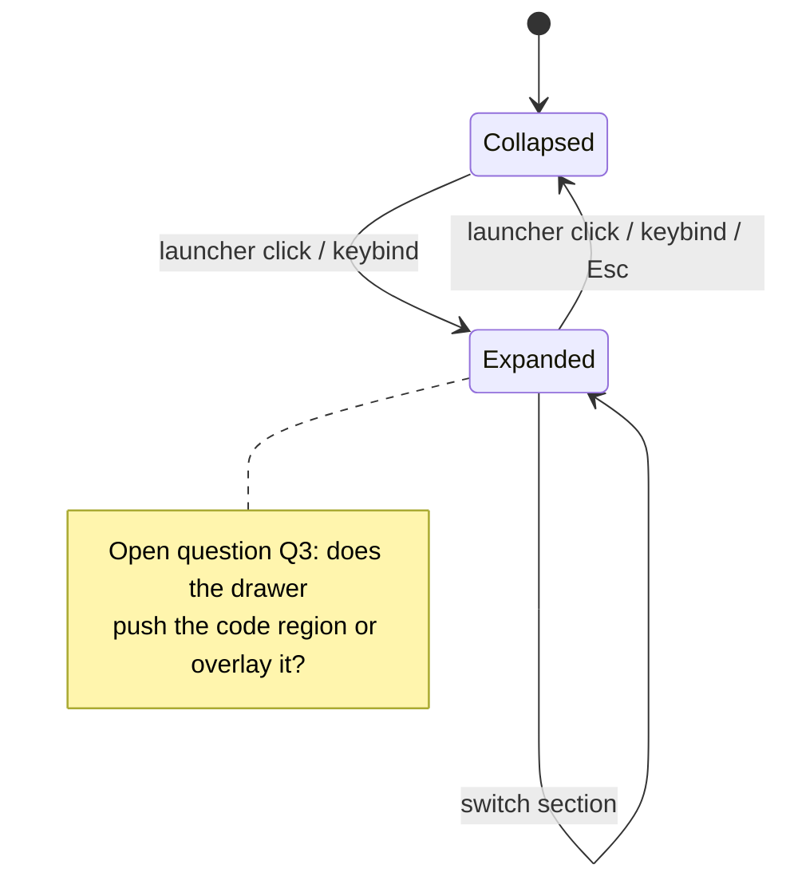

### 4.3 Code region (region 4): tiling

- It behaves like a tiling window manager inside the window: the region is split into **tiles** with gaps.
- **Every thing in the region is a tile**: editors, terminals, run/debug output, problems. No sidebar, no dedicated bottom panel.
- Splits (horizontal/vertical), close, focus movement, resize, swap and move-to-workspace are actions with keybinds in the config file.
- Layout algorithms (dwindle-like, master-like) are config values; **inner gap** and **outer gap** are tokens.

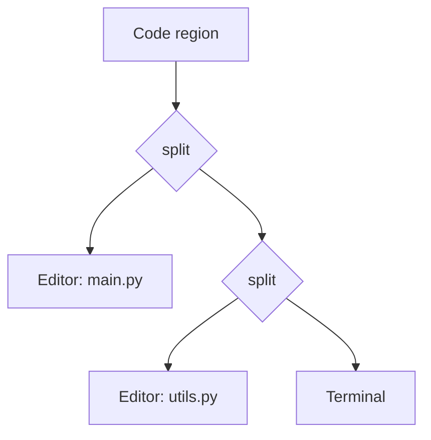

### 4.4 Background layer (region 4b)

**Background depends on the display mode (decided 2026-10-31):**

| Display mode (§4.5) | Background |
|---|---|
| **Windowed** | **No app background at all.** Every area TileIDE doesn't draw stays transparent, so the user's own desktop shows through, with compositor blur where the user's compositor provides it. `tileide.background` settings are ignored. TileIDE blends in with the user's rice. |
| **Full-screen** | **The app's background is in effect, across the whole canvas** (regions 5 and 4b: behind the rail, the gap ring and the tiles), exactly like `design/annotated_layout.png`. The modes below apply. App-drawn modes (image, gradient, solid) are drawn and, if wanted, blurred by TileIDE itself. |

The code region has **two layers**: the **tiles** (4a) on top and a **background layer** (4b) behind them. The background shows in every gap between tiles, in the margin between tiles and the window outline, and behind any tile whose opacity is below 100%.

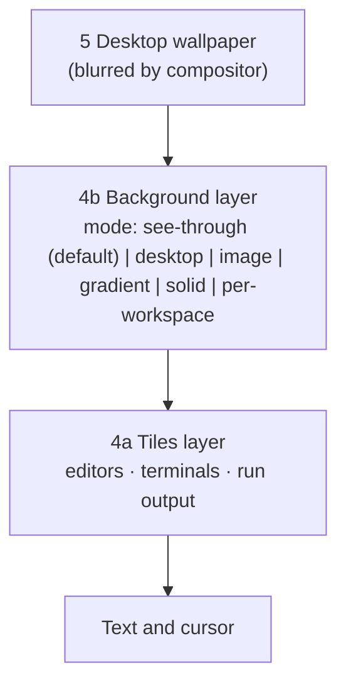

**User-changeable.** Modes:

| Mode | What the user sees | Who draws it | Notes |
|---|---|---|---|
| `see-through` (default) | The desktop wallpaper, blurred | Compositor | What the screenshot shows today. Needs a compositor with blur (T3). |
| `desktop` | Same wallpaper, kept in sync | Compositor / app | "Integrates" with the desktop |
| `image` | A picture the user picks | **App** | Works on every compositor, so it doubles as the **solid fallback** for T3 |
| `gradient` | Two or more colours | App | Cheapest custom look |
| `solid` | One colour | App | Lightest possible |
| `per-workspace` | Each workspace has its own | App | Fits "workspaces are bundles" (§6.2) |

**Controls** (all in config; the sidebar **Themes** section exposes them as a picker with live preview): `source`, `dim` (0–100%), `blur` (0–N px, app-drawn modes only), `tint` (colour overlay), `tile_opacity`, `fit` (cover/contain/tile), and **per-workspace override**.

**Legibility guard.** Code must stay readable on any background. Rules: tiles keep a minimum opacity (editor tiles ≥ 88%, `design/design.md` §4.2) and the app warns, and can auto-dim, when a chosen image fails the contrast check.

**Cost.** Static image/gradient/solid cost almost nothing. **Animated or video backgrounds are out of scope** until proven cheap, because they contradict "lightweight" (they cost GPU and battery continuously).

**Mods can contribute backgrounds** (data-only, v0.5). Large image files are assets, not runtime cost.

### 4.5 Display modes and other apps (decided 2026-10-31, Q1)

| Mode | What TileIDE is | Other apps' windows |
|---|---|---|
| **Full-screen** | The whole canvas (regions 0–5) covers the screen | **Cannot float over it.** TileIDE stays on top until the user leaves full-screen |
| **Windowed** (on a tiling WM) | An ordinary app window that the user's WM places and tiles like any other | The WM tiles them *beside* TileIDE. TileIDE's own window shrinks, but its **internal tile layout is never changed by outside windows**; only TileIDE's own keybinds split the code region |

**Separate modifier.** TileIDE's keybinds use their own modifier (`tileide.keys { mod = ... }`, default `ALT` **[VERIFY with real use]**), never `SUPER`. That way users never confuse TileIDE's tiling with their WM's tiling, and the WM never swallows TileIDE's keys.

## 5. Architecture

### 5.1 System view

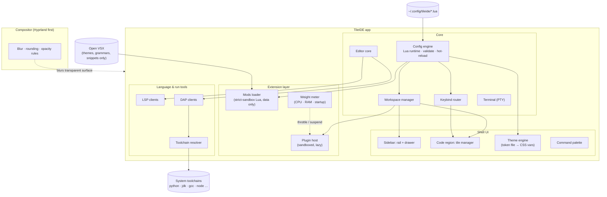

### 5.2 Stack (decided: from scratch, in Rust)

**Decisions (2026-10-31):** TileIDE is built **from scratch**, in **Rust**. It is **not** a fork of VS Code or Theia, and it does **not** run VS Code API extensions. Python and TypeScript/Electron stacks were considered and rejected.

**Language roles (decided 2026-10-31):** **Rust is the whole application.** **Lua is only for configuration and design**, the way Hyprland rices work: settings, keybinds, themes, layouts, backgrounds and shareable rices/mods. Lua never implements app features and is **not a plugin language**.

| Layer | Choice | Status |
|---|---|---|
| Language | Rust | **Decided** |
| UI toolkit | **R1: GTK4 (gtk4-rs) + GtkSourceView 5 + VTE (gtk4)**, cairo renderer. R2 skipped: R1 passed spikes 1, 3 and 4 | **Decided 2026-10-31** |
| Text buffer | Rope-based (e.g. the `ropey` crate **[VERIFY]**) | Proposed |
| Syntax | tree-sitter | Proposed |
| Terminal | R1: VTE **[VERIFY]**; R2: `alacritty_terminal` as a library | Proposed |
| LSP / DAP | Built-in async JSON-RPC clients; servers are separate processes the user installs | Proposed |
| Config | **Lua**, embedded in the Rust binary (e.g. the `mlua` crate **[VERIFY]**); Lua 5.4 vs Luau decided in v0.0 (§6.3) | **Decided: Lua** |
| Config schema | Typed Rust model; the Lua result is validated against it after every run | Proposed |
| File watching | e.g. the `notify` crate **[VERIFY]** | Proposed |
| Plugins | WASM (sandboxed) or out-of-process over RPC **[VERIFY choice]**; Python authors can write out-of-process plugins | Open |
| Wayland | Layer-shell where needed (`gtk4-layer-shell` for R1 **[VERIFY]**); input regions for click-through (T12) | Proposed |
| Hyprland IPC | e.g. the `hyprland` crate **[VERIFY]** | Proposed |
| Packaging | **Arch Linux first** (PKGBUILD → AUR). Other distros (Flatpak, AppImage, …) only after the Arch build is stable | **Decided: Arch first** |

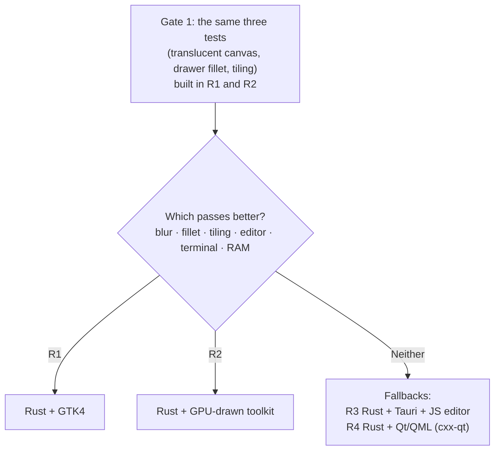

| | R1: GTK4 | R2: GPU-drawn | R3: Tauri | R4: Qt/QML |
|---|---|---|---|---|
| Editor widget | Exists (GtkSourceView) | Build it | Use a JS editor | Build or embed |
| Terminal | VTE **[VERIFY]** | `alacritty_terminal` | JS terminal | Build or embed |
| Fillet + animation | Harder | Closest to the look | CSS, easy | QML, easy |
| Weight | Light | Light | Heavier (web view) | Medium |
| Main risk | Look limits | Builds the most; GPUI has no confirmed official standalone crate **[VERIFY]** | Brings JS back | cxx-qt maturity **[VERIFY]** |

**What we gave up:** VS Code API extensions (webviews, custom editors, anything importing `vscode`). **What replaces it:** LSP and DAP (where most language support actually lives), import of VS Code *declarative* content, and TileIDE's own plugins.

**Honest note:** the toolkit is the risk, not the language. Rust GUI toolkits may lack a finished editor widget, input methods and accessibility **[VERIFY]**, which is why v0.0 builds the same tests twice.

> **Decision gate:** R1 vs R2 is not decided here. v0.0 measures; the numbers choose.

## 6. Core concepts

### 6.1 Mods vs. Extensions (the main trick for staying light)

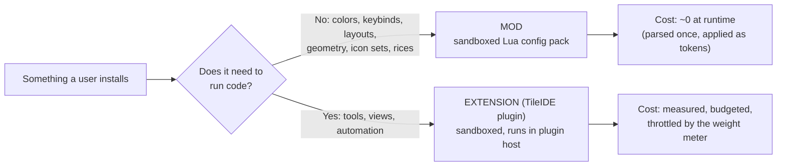

Themes and backgrounds in the sidebar are **mods**. Extensions are **TileIDE plugins**, not VS Code extensions. Language support is neither: it comes from LSP/DAP servers (§6.4).

### 6.2 Workspaces

An **IDE Workspace** is a saved bundle, switched instantly, numbered like Hyprland workspaces. Indicators live in the rail (1b); the vertical label (1c) shows the current one.

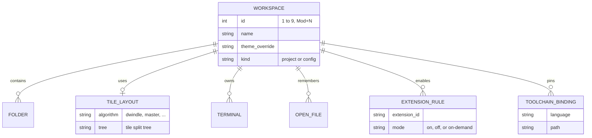

- **The Files section re-roots to the active workspace's folders.**
- **Start state (decided 2026-10-31):** a newly opened TileIDE has **no tiles, and every workspace is empty**. The Config workspace is optional (`sidebar.show_config`; `Alt+C`).
- **Switching (decided 2026-10-31):** `Alt+1…9` and `Alt+0` go to that workspace, **creating it if it doesn't exist yet**. A **+ button** under the rail's workspace indicators (1b) creates the next free workspace.
- **No session restore for now (decided 2026-10-31).** Reopening the workspaces, tiles and files of a past session (like VS Code does) is parked; see `versions/v1.0.md` parking lot.
- **Config workspace** (`kind = config`): a special workspace whose code region opens the app's config files for direct editing, with live preview and inline validation. Whether it is pinned, numbered, or toggled over any workspace is open (Q4).
- Per-workspace extension rules mean a Python workspace doesn't pay for the Rust analyzer: the second lever for "stays light".

### 6.3 Config system (decided: Lua)

**Decided (2026-10-31): the config is Lua.** One language for user config, mods and rices. The Lua runtime is embedded in TileIDE's Rust binary; the config is a Lua script that calls a small `tileide.*` API. **The API names below are a proposal, not final.**

```lua
-- ~/.config/tileide/tileide.lua
tileide.keys { mod = "ALT" }               -- TileIDE's own modifier; SUPER stays with your WM (§4.5)
local mod = "ALT"

tileide.appearance {
  theme         = "dusk",                 -- themes/dusk.lua
  opacity       = 0.82,
  blur_hint     = true,                   -- asks compositor; ignored if unsupported
  window_radius = 22,
  gap_rail      = 24,                     -- 2a: rail <-> window
  gap_outer     = 30,                     -- 2b: window <-> screen edge (top, right, bottom)
}

tileide.sidebar {
  start_state   = "collapsed",
  drawer_fillet = 22,                     -- concave join between rail and drawer
  -- every module can be switched off
  show_launcher   = true,
  show_workspaces = true,
  show_label      = true,
  show_clock      = true,                 -- read-only data
  show_system     = true,                 -- read-only data: network, bluetooth, battery
  show_files      = true,                 -- drawer sections
  show_extensions = true,
  show_themes     = true,
  show_config     = true,
}

tileide.background {
  mode         = "see-through",           -- see-through | desktop | image | gradient | solid
  source       = "~/Pictures/Backgrounds/dusk.jpg",
  dim          = 30,                      -- % darkening, protects legibility
  blur         = 0,                       -- px, app-drawn modes only
  tile_opacity = 0.92,
}

tileide.tiling { layout = "dwindle", gaps_in = 8, gaps_out = 12 }

-- keybinds: tileide.bind(mods, key, action, arg)
tileide.bind(mod,            "1", "workspace", 1)
tileide.bind(mod .. " SHIFT","1", "moveto",    1)
tileide.bind(mod,            "B", "sidebar",   "toggle")
tileide.bind(mod,            "V", "split",     "vertical")
tileide.bind(mod,            "H", "focus",     "left")
tileide.bind(mod,            "C", "workspace", "config")
tileide.bind(mod,            "P", "palette")
tileide.bind("",             "F5","run")

-- workspaces
tileide.workspace(1, { name = "code",  layout = "dwindle" })
tileide.workspace(2, { name = "notes", folder = "~/notes",
                    extensions = "markdown-only",
                    background = "~/Pictures/Backgrounds/paper.jpg" })

-- extension policy, language servers, toolchains
tileide.extension("tileide.markdown-preview", { mode = "on-demand" })
tileide.lsp("rust", { cmd = "rust-analyzer" })
tileide.toolchain("python", { path = "/usr/bin/python3" })   -- discovered automatically; this overrides

-- a rice is just another Lua file; require() is limited to ~/.config/tileide
require("rices.nord")
```

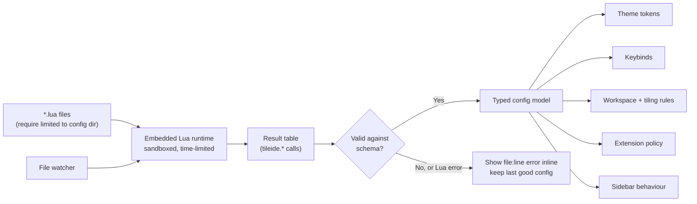

Principles: unknown keys warn, never crash · last-good config always kept · every option has a default · each reload runs in a **fresh Lua state** and is applied only if it validates · `tileide --check-config` for CI/dotfile repos.

**Why Lua, honestly.** Gains: conditionals and loops (per-host or per-monitor config, generating 9 workspaces in a loop), real error messages with file and line for free, a well-known language (WezTerm and Neovim configs are Lua),. Costs: a config is now a *program*, so "simple config" (a pillar) holds only as long as the API stays small; configs can be slow, non-deterministic or hostile; and a GUI that edits the config (e.g. a theme picker) can no longer rewrite it safely (Q15).

**Trust tiers (the answer to "a config can run code").** Earlier drafts said a config could never execute code. With Lua that rule becomes a sandbox rule:

| Tier | Source | Allowed | Not allowed |
|---|---|---|---|
| **User config** | `~/.config/tileide/*.lua` that you wrote | `tileide.*` API, plain Lua (conditionals, loops, string/table/math), read-only `tileide.host` / `tileide.env` values, `require` inside the config dir | Raw `io`, `os.execute`, `package.loadlib`, network. Running a command is a separate, explicit opt-in, off by default (Q16) |
| **Mods and rices** | Downloaded from others (v0.5) | Setters for themes, backgrounds, keybinds, layouts, icon sets, geometry | **Everything else:** no I/O, no network, no process execution, no event callbacks, a hard instruction/time limit |

Rule: a mod is data that happens to be written as Lua. Nothing a stranger shipped gets to run on a timer or on an event. **[VERIFY]** that the chosen Lua binding can enforce the sandbox and an instruction limit (Luau has a sandbox mode built in; plain Lua 5.4 needs a stripped environment and a hook).

**Lua flavour: Luau** (decided 2026-10-31, spike 2). It was the only flavour whose time limit stopped every hostile config, including pattern backtracking; Lua 5.4 / 5.5 / LuaJIT could not. Plugins are **not** written in Lua (§5.2 language roles).

### 6.4 Run / Debug and toolchains

"Include installed compilers" means **discover and link, not bundle**; bundling a JDK + Python + GCC would destroy "lightweight". Run/debug output opens as tiles.

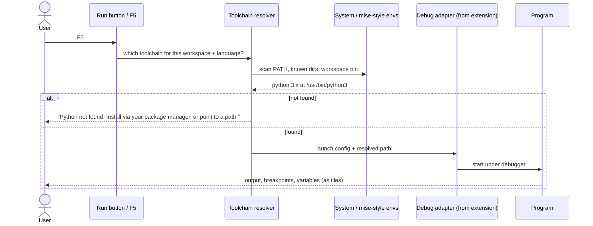

- **Run** = resolve toolchain → launch command from a launch config.
- **Debug** = Debug Adapter Protocol. TileIDE talks DAP to a debug adapter the user has installed (plugins may ship one); debug quality depends on adapter availability for the language **[VERIFY per language]**.
- **Toolchain manager** lists detected compilers/runtimes, pins per workspace, shows the distro's install command; never installs silently.

### 6.5 How "stays light" is enforced

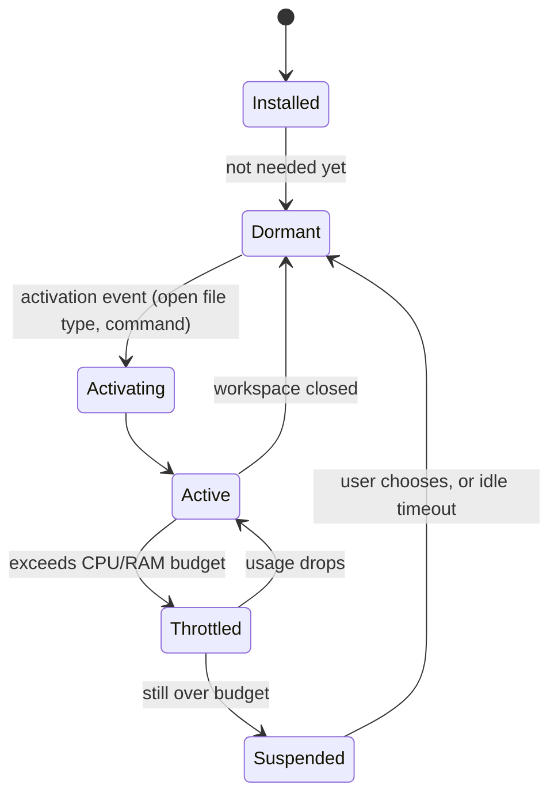

Levers, strongest first: (1) mods are data-only Lua in a strict sandbox with no event hooks and no I/O; (2) per-workspace extension rules; (3) lazy activation; (4) plugin host sandboxed (WASM) or out of process; (5) a **weight meter** (startup, RAM, CPU, suspend button); (6) a warning when an extension asks to activate on `*`.

## 7. Tensions (read before building)

| # | Tension | Why it matters | Stance |
|---|---|---|---|
| **T1** | "VS Code extension library" vs. building from scratch | VS Code extensions are JavaScript written against the VS Code API, which lives inside VS Code's own codebase. A from-scratch Rust editor cannot run them without reimplementing that API (years of work). Microsoft's Marketplace terms also limit its use to Microsoft's own products; the open alternative is **Open VSX**. | **Dropped as a goal.** Replaced by: LSP/DAP built in, import of VS Code *declarative* content (themes, grammars, snippets, keybindings) from Open VSX, and a TileIDE plugin system. **[VERIFY]** which of your must-have extensions are just language servers or themes (will work) vs. need the VS Code API (won't). |
| **T2** | "Lightweight" vs. a plugin ecosystem | Rust makes the base light. The cost moves to plugins: whatever they run can still be heavy. | Same levers (§6.5): mods are data-only Lua, per-workspace rules, lazy activation, sandboxed plugin host, weight meter. Budgets are relative to measured VS Code and Zed on your machine. |
| **T3** | Blur + transparency | The app can only be transparent; **the compositor blurs**. Works on Hyprland; on GNOME/KDE it may not. | Hyprland first; solid-fallback theme for others. **[VERIFY]** on the chosen base. |
| **T4** | The Caelestia bar is a **desktop-shell** element; TileIDE's sidebar is an **app** element | Caelestia's repo is mostly QML on Quickshell, which draws desktop panels. TileIDE can copy the look, not the code. Also, if a user *runs* Caelestia, they'd see **two bars** (the shell's and TileIDE's). | Borrow geometry/colour logic only. **Decided (2026-10-31): the whole canvas, rail included, is TileIDE's;** TileIDE is not meant to run beside Caelestia's own bar. Consequences in T12. |
| **T5** | "Workspaces" is ambiguous | Hyprland workspace = virtual desktop; VS Code workspace = folder + settings. | Defined in §6.2 as a hybrid. Confirm in Q4. |
| **T6** | Hyprland-level config is a scope trap | Hyprland's config grew for years, and a Lua config can grow without limit because it is a language, not a list of keys. | Tiny `tileide.*` API first; every new function or key needs a real use case. Lua is for logic in *your* config, not for building features. |
| **T7** | Scope vs. capacity | IDE + plugin host + config engine + design system + tiling is multi-year. | Kill-gates in `versions/`; v0.1 must be useful on its own. |
| **T8** | "Edit config as a workspace" | Is it a numbered workspace, a pinned slot, a mode? What happens to the tiles of the workspace you were in? | Open (Q4). Needs a decision before v0.2. |
| **T9** | Sidebar lives **outside** the window outline, separated by a gap, **and** is supposed to expand like a Caelestia drawer | Caelestia's drawers merge into the bar with curved joins; your layout deliberately separates the bar from the window with a gap. Expanding toward the window threatens the gap. | Fillet applies **rail ⇄ drawer** only; the gap to the window stays. Whether the drawer pushes or overlays the window is open (Q3). |
| **T10** | Tiling and a custom editor in a Rust toolkit | Rust GUI toolkits rarely ship a finished code editor widget or a tiling manager. Text shaping, selection, input methods and accessibility may need building **[VERIFY per toolkit]**. | R1 gets an editor and terminal for free but is harder to animate; R2 is closest to the look but builds more. Prove in v0.0. |
| **T11** | A custom window background vs. the desktop around it | The gap (region 2) and the rail show the **desktop** wallpaper; a custom image *inside* the window sits next to it, so the two can clash. Also: only the compositor can blur the desktop behind you, so "custom image + transparent tiles" blurs nothing unless the **app** draws and blurs the image itself. | **Decided (§4.4):** windowed = no app background (the desktop shows through); full-screen = the app background covers the whole canvas, so there is no clash with a desktop beside it. App-drawn modes are blurred by TileIDE itself. |
| **T12** | The whole image is TileIDE's canvas | If TileIDE owns the rail, the gap ring and the window, it is effectively a full-screen surface that is mostly transparent. A transparent area of a surface can still intercept the pointer unless an input region is set **[VERIFY]**; compositor blur follows per-window rules, not per region **[VERIFY whether fully transparent pixels can be excluded]**; other apps' windows, fullscreen apps and multi-monitor have no obvious place. | **Q1 decided (§4.5):** full-screen mode keeps other windows off the canvas; windowed mode is a normal WM-tiled window. Prove in v0.0: both surface types, blur only under the window, keyboard focus in full-screen. |
| **T13** | Review burden | The code is written by Claude Code. The Rust compiler catches many errors, but visual and Wayland behaviour can only be judged on your screen, and someone has to be able to read what was written. | Small reviewable steps; every version has exit criteria you can check by using the app; a short architecture note per module. Open question Q14. |
| **T14** | Lua config vs "simple" and vs safety | The decision (2026-10-31) is Lua. A config that is a program can hang, behave differently per run, and run hostile code if it comes from a shared rice. It also makes GUI-edited settings hard (a program cannot be rewritten safely). | Trust tiers (§6.3): your own config is trusted within the sandbox; mods and rices run in a stricter data-only sandbox with time limits. UI-made choices go to a separate state file (Q15). Measure Lua startup in v0.0. |

## 8. Versions (index)

Details, scope, exit criteria and risks per version live in their own files.

| Version | Theme | File |
|---|---|---|
| v0.0 | Spike: go / no-go | [versions/v0.0.md](versions/v0.0.md) |
| v0.1 | Shell: rail, drawer, window, basic tiling | [versions/v0.1.md](versions/v0.1.md) |
| v0.2 | Config + Workspaces + Config workspace | [versions/v0.2.md](versions/v0.2.md) |
| v0.3 | Extensions + Themes (Gate 2) | [versions/v0.3.md](versions/v0.3.md) |
| v0.4 | Run/Debug + Toolchains | [versions/v0.4.md](versions/v0.4.md) |
| v0.5 | Mods + Rice sharing | [versions/v0.5.md](versions/v0.5.md) |
| v1.0 | Stable Linux release | [versions/v1.0.md](versions/v1.0.md) |

## 9. Performance budget (filled in at Gate 1)

Do **not** invent absolute numbers. Measure first.

| Metric | Baseline (VS Code and Zed, your machine) | TileIDE target | Measured TileIDE |
|---|---|---|---|
| Cold start → editable | _TBD_ | e.g. "≤ 70% of VS Code" | |
| Idle RAM, 1 workspace, 0 extensions | _TBD_ | e.g. "≤ 70% of VS Code" | |
| Idle RAM, 15 extensions | _TBD_ | "≤ 1.3× the 0-extension figure" | |
| Config hot-reload latency | n/a | "feels instant (< 100 ms)" | |
| Workspace switch (tiles + tree) | n/a | "< 150 ms" | |
| Sidebar expand/collapse | n/a | "no dropped frames" | |

(The ratios are placeholders to argue about, not facts.)

## 10. Risk register

| Risk | Likelihood | Impact | Mitigation |
|---|---|---|---|
| No VS Code API extensions: a favourite extension doesn't exist | High | High | LSP/DAP and declarative imports cover much; publish what works; plugin SDK |
| "Lightweight" fails once extensions are installed | High | High | §6.5 levers + Gate 2 |
| Layout fights the toolkit (no inner sidebar, tiling, outside-the-outline sidebar) | **High** | High | Prove in v0.0 in both R1 and R2 |
| Fillet/curve rendering fights layout engine | Medium | High | Prove in v0.0 |
| Plugin views have nowhere to live in a sidebar-less code region | Medium | High | Decide in v0.3: expanded drawer or tiles |
| Rust toolkit gaps (editor widget, input methods, accessibility) | High | High | Choose R1 or R2 by measurement; fallbacks R3/R4 |
| Compositor-specific blur looks broken elsewhere | High | Medium | Solid-fallback tokens |
| Config API balloons (Lua makes it easy) | Medium | Medium | Small `tileide.*` API; new function needs a real use case |
| A shared rice or mod runs hostile Lua (T14) | Medium | High | Strict data-only sandbox, no I/O or hooks, time limit; verify the binding enforces it |
| Embedded Lua adds startup time or binary size | Low | Medium | Measure in v0.0; pick 5.4 / LuaJIT / Luau by numbers |
| Full-canvas surface: click-through, blur scope, other apps' windows, multi-monitor (T12) | High | High | Prove in v0.0; Q1 decided (§4.5) |
| Scope vs. available time | High | Fatal | Kill-gates |
| Extensions run arbitrary code | Medium | High | Separate process; capability prompts later |

## 11. Open questions (answer these; they change the plan)

1. ~~**Other apps (T12)**~~ **Decided (§4.5):** full-screen: nothing floats over TileIDE. Windowed: the WM tiles other windows beside it, and they never affect its internal tiles. TileIDE uses its own modifier, not Super.
2. ~~**R1 or R2?**~~ **Decided:** R1, GTK4 (see `decisions.md`).
3. ~~**Drawer behaviour (T9)**~~ **Decided:** push; the gap to the window keeps its width, and the drawer's width can be dragged with the mouse.
4. **Config workspace (T8):** a numbered workspace, a toggle over any workspace, or a separate window? What happens to the tiles you were in?
5. **Tabs:** does each tile show a tab strip, or is one tile exactly one buffer?
6. **Rail data:** the buttons are gone. Which read-only data should exist (clock/date, network, bluetooth, battery, CPU/RAM, …), how is each shown (text, glyph, tiny graph), and where does it come from?
7. **What does "lightweight" mean as a number** (seconds, MB, on what hardware)?
8. **Which 5 VS Code extensions do you rely on?** For each: is it just a language server, debugger or theme (works) or does it need the VS Code API (won't)?
9. **Lua flavour and API shape:** Lua is decided. Do you want function-call style as in §6.3 (`tileide.bind(...)`), or one big returned table? (Decided with a sample you can read in v0.0.)
10. **Who builds this, alongside what?** What weekly time, and which commitments does it displace?
11. ~~**Background vs. desktop (T11)**~~ **Decided (§4.4):** full-screen draws the background behind the whole canvas (rail and gap included); windowed draws none.
12. **Background scope:** is one global background enough, or per-workspace from the start? Are animated/video backgrounds a real wish, given their continuous cost?
13. **Gap ownership:** are the outer gap (2b) and the left gap (2a) one value or two? Should users be able to set 2b to 0 for a flush window?
14. **Review (T13):** can you read and review Rust, or will you rely on behaviour and tests only?
15. **GUI-made settings (T14):** when you pick a theme or background in the sidebar, where is it saved? A separate state file that your `tileide.lua` can override, or does TileIDE never write config at all?
16. **Running commands from config:** Hyprland configs commonly launch programs (`exec-once`). Should TileIDE's Lua config be allowed to, behind an explicit opt-in, or never?

## 12. Sources

- Open VSX / Marketplace terms: [Open VSX (Wikipedia)](https://en.wikipedia.org/wiki/Open_VSX) · [DevClass](https://www.devclass.com/development/2023/06/27/open-vsx-alternative-to-vs-code-marketplace-saved-from-closure-by-new-eclipse-working-group/1625540) · [Posit support note](https://support.posit.co/hc/en-us/articles/30809946887319-VS-Code-Marketplace-extensions-not-available-in-VSCode-on-Posit-Workbench)
- Caelestia shell is QML on Quickshell, config via `shell.json`, Hyprland global shortcuts: [caelestia-dots/shell](https://github.com/caelestia-dots/shell)
- Hyprland config conventions (naming and bind feel only): [Hyprland wiki](https://wiki.hyprland.org/)
- Embedding Lua from Rust: [`mlua` on docs.rs](https://docs.rs/crate/mlua/latest) (search gave a title only; sandboxing, instruction limits and Luau support **[VERIFY]**) · Lua as an application config language, for comparison: [WezTerm Lua config](https://wezterm.org/config/lua/config/wayland_window_background_blur.html)
- Rust stack evidence (partial; search results gave titles only): [GPUI README in Zed's repo](https://github.com/zed-industries/zed/blob/main/crates/gpui/README.md) · [gpui-ce fork](https://docs.rs/gpui-ce/0.3.0/gpui/_documentation/comparison/index.html) · [alacritty_terminal](https://packages.fedoraproject.org/pkgs/rust-alacritty_terminal/rust-alacritty_terminal+default-devel/) · [iced_term](https://docs.rs/crate/iced_term/latest/source/) · [WezTerm Wayland blur](https://wezterm.org/config/lua/config/wayland_window_background_blur.html) · [KDE thread: layer-shell-qt and Python](https://discuss.kde.org/t/python-bindings-for-layer-shell-qt/26489)
- Not yet checked: GTK4/GtkSourceView/VTE availability from Rust, whether GPUI is usable standalone, Wayland click-through for the chosen toolkit, plugin host choice (WASM vs out-of-process), and every crate marked **[VERIFY]**.
